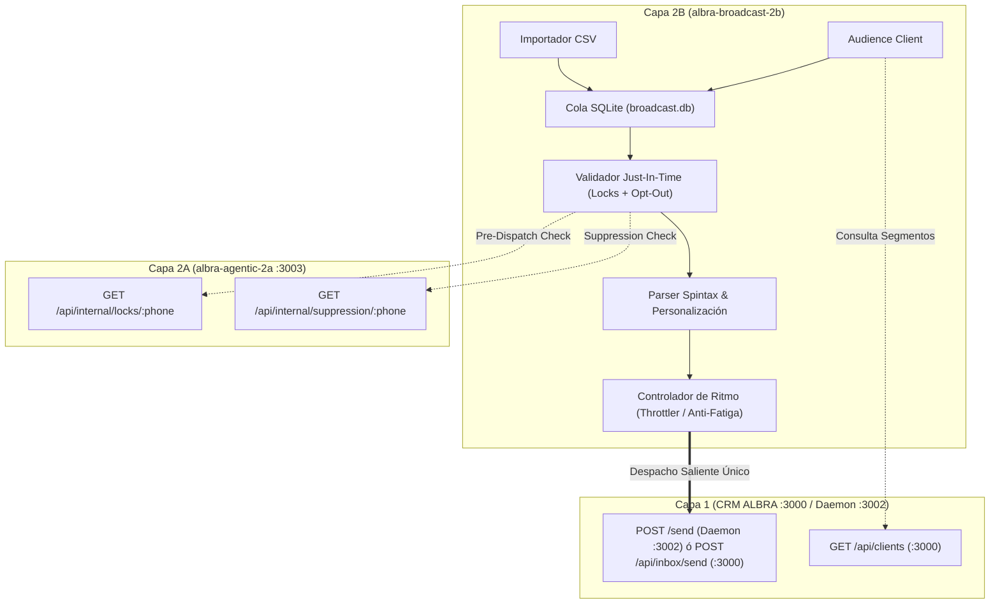
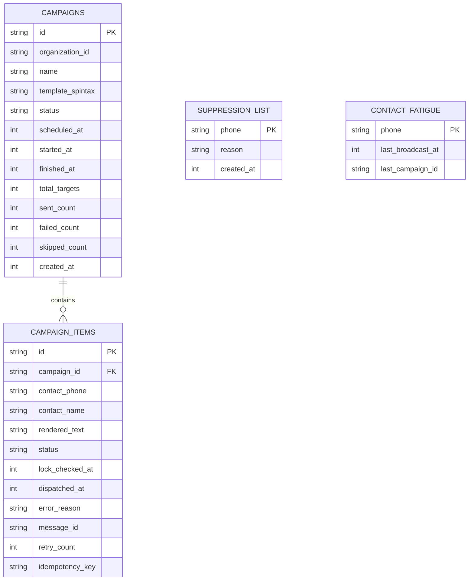

# FICHA TÉCNICA Y ESPECIFICACIÓN ARQUITECTÓNICA
# Capa 2B: Satélite de Difusión Masiva y Chat Marketing (`albra-broadcast-2b`)

**Proyecto:** ALBRA Broadcast & Superpowers (Capa 2B)  
**Ubicación de Destino:** `clones/albra-broadcast-2b/`  
**Estado:** Especificación Técnica Aprobada para Diseño (CERO código implementado en esta fase)  
**Fecha:** 24 de Octubre de 2026  
**Documento Maestro:** [`investigacion_camino/PROPUESTA_DISENO_CONTRATOS_2A_2B.md`](file:///d:/NAS%20CLONADOR/investigacion_camino/PROPUESTA_DISENO_CONTRATOS_2A_2B.md)

---

## 1. Identificación, Propósito y Límites de Responsabilidad

### 1.1 Propósito
La **Capa 2B** es un componente satélite diseñado exclusivamente para gestionar **campañas salientes masivas y programadas** (WhatsApp Broadcast / Difusiones) hacia audiencias legítimas, aplicando políticas estrictas de ritmo (throttling), pausas de enfriamiento, variación léxica legítima (spintax) y respeto absoluto a la privacidad, estados conversacionales y políticas de canal.

### 1.2 Límites de Responsabilidad Arquitectónica
1. **Cero Acceso Directo a la BD Comercial:** Capa 2B **no** accede directamente a `audit_repos/CRM-ALBRA/db/custom.db`. Utiliza su propia base de datos operativa independiente (`db/broadcast.db`) para colas, plantillas y registros de auditoría de campañas.
2. **Cero Diálogo 1-a-1:** Capa 2B **nunca** gestiona respuestas ni mantiene diálogos interactivos. En cuanto un contacto responde a un broadcast, la interacción es capturada por el webhook del CRM y procesada por la **Capa 2A** o derivada al asesor humano.
3. **Cero Sockets Propios de WhatsApp:** Capa 2B **no** ejecuta instancias de Baileys ni abre conexiones WebSocket directas hacia Meta/WhatsApp. Todo despacho saliente se realiza mediante los contratos HTTP internos del CRM / Daemon existente, garantizando una única sesión y trazabilidad íntegra en la bandeja del CRM.
4. **Subordinación Estricta a los Locks de Capa 2A:** Si un contacto está en medio de una conversación activa (`IN_FLOW_2A`) o ha sido derivado a un humano (`HANDOFF_HUMAN`), Capa 2B tiene **terminantemente prohibido** enviarle mensajes de difusión.

---

## 2. Contratos de Integración y Dependencias



### 2.1 Ingesta de Audiencias (Fuentes de Contactos)

#### Modo A: Importación Manual vía Archivo CSV
- **Formato:** UTF-8 con delimitador coma (`,`) o punto y coma (`;`).
- **Esquema de Columnas:**
  - `phone` (Obligatorio): Número telefónico nacional o internacional.
  - `name` (Opcional): Nombre del destinatario para personalización (`{{name}}`).
  - `custom_var_*` (Opcional): Variables adicionales para combinación de plantilla.
- **Validación al Ingestar:**
  - Canonización obligatoria E.164 según prefijo de país (en Colombia: `573XXXXXXXXX`).
  - Descarte inmediato de números inválidos, incompletos o fijos no móviles.
  - De-duplicación automática dentro del mismo archivo CSV.

#### Modo B: Consulta de Audiencias del CRM ALBRA
- **Interfaz Identificada en Capa 1:** `GET /api/clients?page=1&limit=50&status=prospect` en el CRM (`:3000`).
- **Autenticación:** `Authorization: Bearer <API_KEY_ORG>` o JWT interno de servicio.
- *Dependencia Pendiente de Definir en Capa 1:* Actualmente el endpoint `/api/clients` está orientado a la UI paginada. Para campañas de gran volumen, se requerirá formalizar un endpoint de segmento/exportación por filtros masivos (ej. `POST /api/crm/audiences/query` o exportación CSV vía `/api/export/csv?type=clients`). Mientras esto se estandarice en Capa 1, la vía primaria y probada de Capa 2B será la importación vía archivo CSV.

---

### 2.2 Despacho Saliente (Single-Responder Authority)

Capa 2B delega el despacho exclusivamente en el CRM:
- **Endpoint Primario:** `POST http://localhost:3002/send` (Daemon Baileys interno).
  - **Headers:** `Authorization: Bearer <INTERNAL_API_SECRET>`, `Content-Type: application/json`
  - **Payload:**
    ```json
    {
      "to": "573017543786",
      "text": "Hola Johan, te compartimos nuestra actualización comercial..."
    }
    ```
  - **Respuesta Esperada:** `200 OK` `{ "success": true, "messageId": "..." }`
- **Alternativa Vía CRM API:** `POST http://localhost:3000/api/inbox/send` con autenticación de host.

---

### 2.3 Interconexión con Capa 2A (Consulta de Locks y Supresiones)

Capa 2B consume los endpoints internos expuestos por Capa 2A en el puerto `3003`:

#### A. Consulta de Locks Conversacionales
- **Endpoint:** `GET http://localhost:3003/api/internal/locks/:phone`
- **Parámetro:** `:phone` canonizado (ej. `573017543786`).
- **Respuesta de Capa 2A:**
  ```json
  {
    "phone": "573017543786",
    "locked": true,
    "lock": {
      "contact_phone": "573017543786",
      "organization_id": "cmvm3i89j0000uy7w660l8lc0",
      "current_state": "IN_FLOW_2A",
      "locked_at": 1792830316,
      "expires_at": 1792831216,
      "correlation_id": "afc3e199-5868-476a-baae-a405235f8276"
    }
  }
  ```

#### B. Consulta de Lista de Supresión (Bajas y Opt-Out)
- **Endpoint:** `GET http://localhost:3003/api/internal/suppression/:phone`
- **Respuesta de Capa 2A:**
  ```json
  {
    "phone": "573017543786",
    "suppressed": false
  }
  ```

---

## 3. Política de Locks, Semántica y Mitigación de Ventana de Carrera

Para asegurar que un cliente en diálogo con el bot 2A o atendido por un humano en el CRM nunca sea interrumpido por un mensaje masivo publicitario, se implementa una **política de Doble Verificación (Double-Check)**:

### 3.1 Doble Comprobación de Locks
1. **Fase 1 — Pre-filtrado al Encolar (Queue Enqueue Check):**
   - Antes de admitir un registro en la cola de despacho de una campaña, se consulta `GET /api/internal/locks/:phone`.
   - Si el lock está activo en estados `IN_FLOW_2A` o `HANDOFF_HUMAN`, el contacto se excluye de la campaña con estado `EXCLUDED_LOCK_ACTIVE`.
2. **Fase 2 — Comprobación Just-In-Time (Pre-Dispatch Immediate Check):**
   - Una campaña puede tardar horas en despacharse. Un contacto que estaba libre al iniciar la campaña pudo haber escrito al bot hace 2 minutos.
   - Por tanto, **inmediatamente antes de invocar el despacho HTTP** (en el mismo hilo de ejecución, $< 50\text{ ms}$ antes del POST de envío), el worker consulta nuevamente el estado del lock a Capa 2A.
   - Si el contacto adquirió un lock en ese intervalo, se suspende el envío y el ítem se marca como `ABORTED_LOCK_ACTIVE`.

### 3.2 Principio Fail-Closed Estricto
- Si la llamada a Capa 2A (`:3003`) sufre un timeout ($> 1500\text{ ms}$), error de red o devuelve una respuesta no concluyente o corrupta:
  $$\text{Resultado de Fallo/Indeterminación} \Longrightarrow \text{\textbf{NO DESPACHAR}}$$
- El ítem se marca en estado `SKIPPED_LOCK_UNAVAILABLE` y se reprograma para el siguiente ciclo. Bajo ninguna circunstancia se enviará un mensaje masivo si no es posible comprobar el estado de lock.

### 3.3 Mitigación de la Ventana de Carrera (Race Condition Window)
La ventana de carrera entre la comprobación final de Capa 2B y el despacho saliente se minimiza mediante:
1. **Comprobación local en memoria + HTTP síncrono ultra-rápido:** Latencia de verificación en red local $< 5\text{ ms}$.
2. **Despacho atómico inmediato:** La instrucción de envío saliente se emite en el siguiente tick del event loop tras recibir `locked: false`.
3. **Notificación reversa a 2A:** Tras el despacho exitoso, 2B notifica a 2A para que este registre un estado temporal `CAMPAIGN_DISPATCHED`, de modo que si el cliente responde en los siguientes 60 segundos, Capa 2A sepa que es una respuesta atribuida a la campaña.

---

## 4. Variaciones Legítimas de Contenido (Spintax) y Personalización

### 4.1 Definición y Propósito
El motor de Spintax permite definir alternativas léxicas naturales en las plantillas salientes:
- **Sintaxis:** `{Opción 1|Opción 2|Opción 3}`
- **Ejemplo:**
  ```text
  {Hola|Buen día|Un cordial saludo} {{name}}, {te compartimos|te presentamos|queremos mostrarte} nuestras soluciones comerciales.
  ```
- **Declaración Ética y Normativa:** El propósito del Spintax en Capa 2B es **la personalización genuina y la variación estilística natural del mensaje**, evitando la monotonía de texto idéntico. **No se diseñan ni implementan técnicas de evasión algorítmica ni ofuscación de contenidos destinadas a burlar los sistemas de seguridad de WhatsApp**.

### 4.2 Resolución Determinística Basada en Semilla
Para garantizar que si un mensaje falla y debe reintentarse, no se envíe un texto radicalmente diferente:
- La selección de variantes de spintax se resuelve mediante un generador pseudoaleatorio alimentado por la semilla:
  $$\text{Seed} = \operatorname{hash}(\text{campaign\_id} + \text{contact\_phone})$$
- Esto garantiza reproducibilidad e idempotencia de la plantilla generada para cada contacto.

---

## 5. Límites Operativos, Anti-Fatiga y Horarios Comerciales

> [!IMPORTANT]
> Los siguientes límites operativos son parámetros técnicos configurables diseñados para una operación responsable de canal y mitigación de sobrecarga del socket. **No constituyen ninguna garantía absoluta o infalible contra suspensiones de cuentas por parte de Meta**. La reputación del número depende del consentimiento previo del usuario, la calidad del contenido y la tasa de reportes de los destinatarios.

### 5.1 Parámetros Operativos por Defecto

| Parámetro | Valor Inicial Propuesto | Justificación Operativa |
| :--- | :---: | :--- |
| **Intervalo entre Mensajes** | `15 a 35 segundos` | Jitter aleatorio para disipar ráfagas simultáneas en el socket. |
| **Pausa de Enfriamiento por Lote** | `5 a 8 minutos` | Se aplica automáticamente cada bloque de `25 mensajes`. |
| **Regla de Fatiga Máxima** | `1 broadcast / 7 días` | Un mismo contacto no puede recibir más de 1 difusión masiva semanal. |
| **Horario Comercial Permitido** | `08:00 a 18:00 (Lun–Sáb)` | Zona horaria `America/Bogota`. Se pausan envíos nocturnos y festivos. |
| **Límite de Reintentos por Error** | `Máximo 2 reintentos` | Backoff exponencial (5 min, 15 min); tras 2 fallos, se marca `FAILED_FATAL`. |

---

## 6. Modelo de Datos Propuesto para `broadcast.db`

Base de datos SQLite local e independiente en `clones/albra-broadcast-2b/db/broadcast.db`:



---

## 7. Máquina de Estados

### 7.1 Estados de la Campaña (`campaigns.status`)
- `DRAFT`: Campaña creada en preparación, sin encolar.
- `SCHEDULED`: Programada para ejecutarse en una fecha/hora futura.
- `RUNNING`: Worker activo despachando mensajes respetando intervalos.
- `PAUSED_COOLDOWN`: En pausa obligatoria de enfriamiento tras lote de 25 mensajes.
- `PAUSED_OFF_HOURS`: En pausa automática por encontrarse fuera de la ventana de horario comercial.
- `COMPLETED`: Todos los ítems fueron procesados (`SENT`, `EXCLUDED` o `FAILED`).
- `CANCELLED`: Interrumpida manualmente por el operador.
- `FAILED`: Abortada por error estructural (ej. daemon de WhatsApp desconectado de forma prolongada).

### 7.2 Estados del Ítem de Campaña (`campaign_items.status`)
- `PENDING`: Esperando turno de despacho en la cola.
- `LOCK_EXCLUDED`: Descartado en fase de pre-filtrado por lock conversacional activo en 2A.
- `SUPPRESSED`: Descartado por encontrarse en la lista de bajas (`STOP`/`BAJA`).
- `FATIGUE_EXCLUDED`: Descartado por haber recibido un broadcast en los últimos 7 días.
- `DISPATCHING`: Petición de comprobación final o envío HTTP en tránsito (transitorio).
- `SENT`: Confirmado por el CRM/Daemon con ID de mensaje retornado.
- `FAILED_RETRYABLE`: Fallo temporal de red; reprogramado con backoff.
- `FAILED_FATAL`: Número inexistente en WhatsApp o rechazado de forma definitiva tras reintentos.
- `ABORTED_LOCK_ACTIVE`: Cancelado en la comprobación Just-In-Time porque el contacto inició conversación con 2A.

---

## 8. Idempotencia, Bajas, Recuperación ante Reinicios y Cumplimiento

### 8.1 Clave de Idempotencia por Contacto y Campaña
Cada ítem en la cola genera una clave unívoca:
$$\text{idempotency\_key} = \operatorname{hash}(\text{campaign\_id} + \text{contact\_phone})$$
- Evita que un mismo contacto sea ingresado dos veces en la misma campaña.
- Si la cola se reinicia, ningún ítem en estado `SENT` podrá volver a despacharse.

### 8.2 Recuperación ante Reinicios o Caídas del Proceso (Crash Recovery)
Si el proceso de Capa 2B se reinicia intempestivamente durante una campaña activa:
1. Al arrancar, el worker busca ítems en estado transitorio `DISPATCHING`.
2. Para evitar duplicidades, no reenvía inmediatamente; consulta en `db/broadcast.db` o al CRM si el mensaje fue registrado. Si no hay confirmación segura, el ítem se mueve a `FAILED_RETRYABLE` para una revisión controlada.
3. Los ítems `PENDING` continúan su orden de despacho programado.

### 8.3 Consentimiento, Bajas y Políticas de Privacidad
1. **Procedencia de la Audiencia:** La interfaz de ingesta exigirá confirmación explícita del operador de que los contactos cuentan con autorización previa de tratamiento de datos (Ley 1581 / Habeas Data en Colombia).
2. **Procesamiento de Opt-Out:**
   - Si un usuario responde con cualquier palabra clave de baja (`STOP`, `BAJA`, `SALIR`, `CANCELAR`):
     - Capa 2A lo registra en su `suppression_list` local.
     - Capa 2B consulta este store y lo replica en su tabla local `SUPPRESSION_LIST`.
     - El contacto queda permanentemente excluido de cualquier campaña futura.

---

## 9. Criterios de Aceptación para la Futura Implementación

| # | Criterio de Aceptación | Resultado Verificable |
| :---: | :--- | :--- |
| **CP-B01** | Ingesta y validación de CSV | Carga archivo CSV con 100 registros; canoniza a E.164, descarta teléfonos inválidos y de-duplica correctamente. |
| **CP-B02** | Exclusión por Lock Conversacional (Pre-filtrado) | Contacto con lock activo en 2A (`IN_FLOW_2A` o `HANDOFF_HUMAN`) es excluido de la cola con estado `LOCK_EXCLUDED`. |
| **CP-B03** | Cancelación Just-In-Time | Contacto que adquiere lock en 2A mientras la campaña corre es detectado en la comprobación pre-dispatch y abortado antes del POST de envío. |
| **CP-B04** | Fail-Closed ante Caída de 2A | Si Capa 2A está caída o da timeout en la consulta de lock, el mensaje **NO** se envía y se marca `SKIPPED_LOCK_UNAVAILABLE`. |
| **CP-B05** | Exclusión por Supresión (Opt-Out) | Teléfono registrado en lista de bajas es omitido automáticamente de la campaña con estado `SUPPRESSED`. |
| **CP-B06** | Variación de Spintax Determinista | Mismo contacto reintentado genera el mismo texto spintax; contactos distintos reciben variantes diferenciadas del catálogo. |
| **CP-B07** | Cumplimiento de Throttling y Jitter | Medición de tiempos entre envíos consecutivos dentro del rango estricto de 15 a 35 segundos. |
| **CP-B08** | Pausa de Enfriamiento por Lotes | Al alcanzar 25 envíos consecutivos, el worker se suspende automáticamente durante 5–8 minutos antes de continuar. |
| **CP-B09** | Respeto de Horario Comercial | Si el reloj del sistema marca fuera de 08:00–18:00 hora local, la campaña pasa a `PAUSED_OFF_HOURS` y espera la ventana hábil. |
| **CP-B10** | Recuperación tras Caída del Proceso | Matar el proceso a la mitad de una campaña y reiniciar; los ítems ya enviados (`SENT`) no se duplican y la campaña reasume limpiamente. |

---

## 10. Riesgos Identificados y Decisiones Pendientes de Aprobación

1. **Dependencia de Endpoint de Audiencias del CRM:**
   - *Riesgo:* `/api/clients` en el CRM está pensado para paginación de UI.
   - *Decisión pendiente:* Confirmar si en la primera fase de Capa 2B la ingesta será **100% mediante archivo CSV**, postergando la creación de endpoints de consulta masiva en el CRM para no alterar Capa 1.
2. **Canal de Despacho Saliente del CRM:**
   - *Riesgo:* `POST http://localhost:3002/send` en el daemon Baileys requiere `INTERNAL_API_SECRET` compartido; `POST /api/inbox/send` en Next.js requiere JWT de usuario.
   - *Decisión recomendada:* Utilizar `POST http://localhost:3002/send` con el `INTERNAL_API_SECRET` ya validado durante el piloto real de 2A, lo cual desacopla a 2B de la sesión web de usuarios.
3. **Persistencia de Métricas de Entrega:**
   - Los reportes de entrega (ticks de recibido/leído en WhatsApp) dependen de eventos asíncronos de Baileys que actualmente no se reenviaban hacia satélites. En la fase inicial de 2B, el estado `SENT` certifica la entrega exitosa al socket de WhatsApp.
